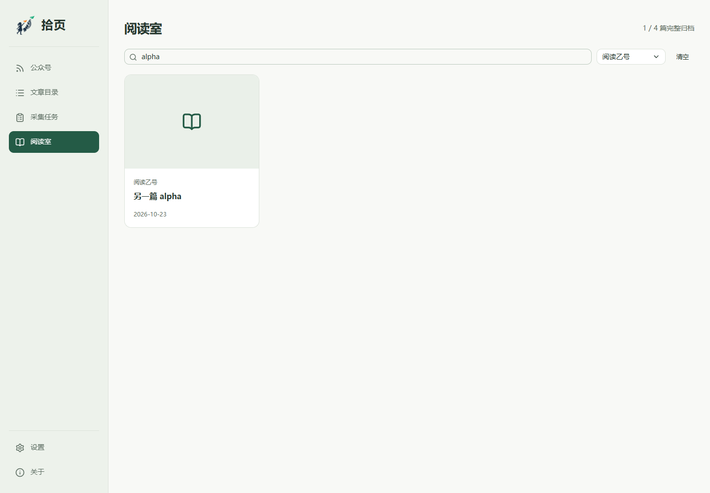

<p align="center">
  
</p>

<h1 align="center">拾页 · Shiye</h1>

<p align="center">Save selected WeChat public-account articles and read them offline on Windows.</p>
<p align="center">Discover the list, choose what to download, and keep text and images in your local library.</p>

<p align="center">
  
  
  <a href="LICENSE"></a>
</p>

<p align="center">
  <a href="https://github.com/V-ChuXuan/shiye/releases/latest">Download</a> ·
  <a href="#quick-start">Quick Start</a> ·
  <a href="docs/usage.md">Guide</a> ·
  <a href="README.zh-CN.md">简体中文</a>
</p>

## Demo



The interface is currently in Chinese. The screenshot uses a test library.

## Install

Download the Windows x64 ZIP from [Releases](https://github.com/V-ChuXuan/shiye/releases/latest), extract the complete folder and open `拾页.exe`. Keep the adjacent files and folders; no separate Node.js installation is needed.

## Quick Start

1. Open Shiye and paste a public article link to add its account.
2. Open an article from that account in desktop WeChat, then click **连接微信** in Shiye.
3. Click **发现文章** to get the list and set this run's article and batch limits.
4. Select articles in **文章目录** and download them. Discovery does not download articles automatically.
5. Open **阅读室** to read saved text and images. Enlarged images stay in the same window.

Closing the window hides it to the tray. Choose **退出拾页** in the tray menu to quit.

## Features

- Discover history and new articles, then download only the articles you choose.
- Keep task progress after interruptions and continue when ready.
- Read article text and galleries offline, with adjustable columns and saved reading positions.
- Save images in account-name/article-title folders and choose their location in Settings.
- Back up and restore the complete library through the native application menu.

## Usage

Change the image folder in **设置**. Existing images stay readable at their original location unless you select **同时迁移已有图片**. For backups, use the tray or Alt application menu and keep the whole backup folder.

If WeChat requests verification or the connection expires, handle it in WeChat, reconnect and explicitly continue the task. Detailed discovery limits, selection behavior and recovery steps are in the [guide](docs/usage.md).

## Limitations

- Collection depends on Windows desktop WeChat and its non-public listing interface. Complete history and unattended operation are not guaranteed.
- This is an unsigned Windows x64 portable application, without an installer or automatic updates.
- Saved articles and images retain their authors' rights; MIT applies to the software. See [further limitations](docs/usage.md#已知限制).

## Development

Build from source on Windows x64 with Node.js 24 LTS:

```sh
npm ci
npm run desktop:package
```

See [development and configuration](docs/usage.md#source-development), [desktop behavior](docs/desktop.md), [UI sources](docs/ui-foundation.md) and the [publication checklist](docs/publishing.md). Verification commands and known reliability limits are documented there.

## License

[MIT](LICENSE)

## Credits

- [shadcn/ui](https://github.com/shadcn-ui/ui) and [Base UI](https://github.com/mui/base-ui) provide the component source and interaction primitives.
- [Lucide](https://github.com/lucide-icons/lucide) provides the interface icons.
- [Electron](https://github.com/electron/electron) hosts the desktop application. See [third-party notices](THIRD_PARTY_NOTICES.md) for the full attribution details.

<p align="center"><sub>If Shiye is useful to you, a ⭐ helps others find it.</sub></p>
